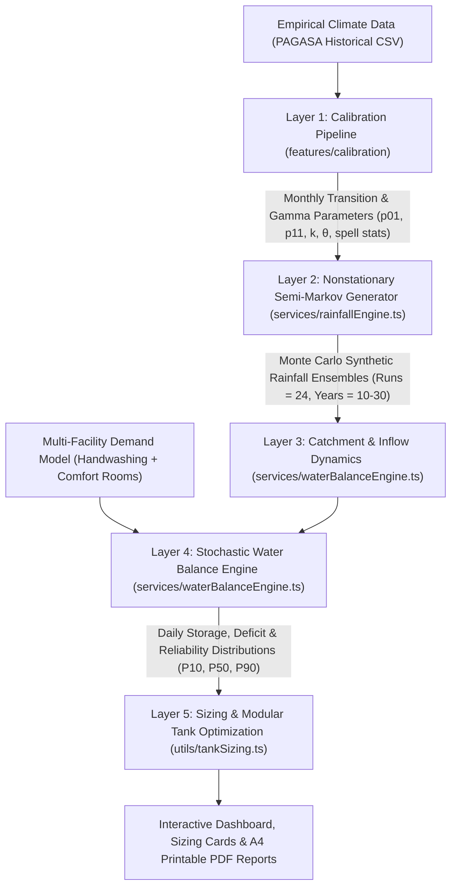

# Simplified Technical Specification

## Matching Research Study
**"A Nonstationary Semi-Markov Rainfall Synthesis and Stochastic Water-Balance Reliability Framework for Optimizing School Rainwater Harvesting Systems"**

---

### Executive Summary

This specification document outlines the computational architecture, mathematical formulations, and engineering decision rules implemented in the **School Rainwater Harvesting System (RWH) Simulation Platform**. 

The platform addresses a fundamental limitation in traditional school rainwater harvesting designs: standard sizing models rely on historical mean monthly rainfall, completely ignoring rainfall sequence variability, inter-annual droughts, and dry spell persistence. In tropical monsoon environments (such as the Philippines' Type I and Type III climate zones), seasonal dry spells frequently empty undersized tanks despite high annual rainfall totals. 

To overcome this, the platform couples:
1. A **Nonstationary Semi-Markov Weather Generator** that reproduces seasonal wet/dry spell duration distributions and daily rainfall depths.
2. A **Catchment Hydrology Model** with initial first-flush abstraction and collection efficiency factors.
3. A **Multi-Facility Water Demand Engine** grounded in DepEd WinS Order 10 s.2016 and WHO/UNICEF WASH guidelines.
4. A **Monte Carlo Daily Water Balance Engine** executing Yield-After-Spill (YAS) recursive mass balance with burn-in cycle initialization across multi-run ensembles.
5. An **Optimization & Modular Tank Sizing Engine** identifying the Pareto-optimal "knee of the curve" (diminishing marginal returns) and decomposing large storage volumes into commercial multi-tank parallel batteries.

---

## 1. System Framework & End-to-End Workflow

The simulation framework operates across four sequential computational layers:



---

## 2. Layer 1: Empirical Parameter Calibration

Historical daily precipitation records (e.g., PAGASA station data from Roxas City and Iloilo) are calibrated into twelve monthly parameter sets.

### 2.1 State Definition & Transition Probability Matrix
Daily weather is classified as a binary state based on a defined precipitation threshold ($R_{\text{threshold}} = 0.1\text{ mm}$):
- State 0 (Dry Day): $R_t < 0.1\text{ mm}$
- State 1 (Wet Day): $R_t \ge 0.1\text{ mm}$

For each month $m \in \{1, 2, \dots, 12\}$, daily transition frequencies are counted:
$$n_{00}(m), \quad n_{01}(m), \quad n_{10}(m), \quad n_{11}(m)$$

The monthly conditional transition probabilities are:
$$p_{01}(m) = P(W_t \mid D_{t-1}) = \frac{n_{01}(m)}{n_{00}(m) + n_{01}(m)}$$
$$p_{11}(m) = P(W_t \mid W_{t-1}) = \frac{n_{11}(m)}{n_{10}(m) + n_{11}(m)}$$

Where:
- $p_{01}(m)$ is the probability of a wet day following a dry day in month $m$.
- $p_{11}(m)$ is the probability of a wet day following a wet day (wet spell persistence) in month $m$.

### 2.2 Precipitation Depth Distribution Fitting
For all observed wet days within month $m$, daily rainfall depth $x$ is modeled using a two-parameter Gamma distribution $\Gamma(k, \theta)$ with probability density function:
$$f(x; k, \theta) = \frac{1}{\theta^k \Gamma(k)} x^{k-1} e^{-\frac{x}{\theta}}, \quad x > 0, \; k > 0, \; \theta > 0$$

Using the **Method of Moments**, parameters are estimated from sample mean $\bar{x}_m$ and sample variance $s_m^2$:
$$\hat{k}_m = \frac{\bar{x}_m^2}{s_m^2} \quad (\text{shape parameter})$$
$$\hat{\theta}_m = \frac{s_m^2}{\bar{x}_m} \quad (\text{scale parameter})$$

---

## 3. Layer 2: Nonstationary Semi-Markov Rainfall Synthesis

Implemented in `services/rainfallEngine.ts`.

### 3.1 Nonstationarity
Weather processes exhibit strong seasonality. The generator updates its parameter vector $[\hat{p}_{01}, \hat{p}_{11}, \hat{k}, \hat{\theta}, \mu_{\text{spell}}, \sigma^2_{\text{spell}}]$ continuously based on the current day's calendar month $m(t)$.

### 3.2 Semi-Markov Alternating Renewal Process
Standard first-order Markov chains assume geometric spell duration distributions with memoryless properties. In real monsoonal climates, dry spells and wet spells exhibit overdispersion ($\sigma^2_{\text{spell}} > \mu_{\text{spell}}$) due to persistent synoptic weather patterns (monsoon surges, typhoons, and ITCZ positioning).

The engine implements a **Semi-Markov Alternating Renewal Model**:
1. When $\sigma^2_{\text{spell}} > \mu_{\text{spell}}$, spell length $L$ is sampled from an overdispersed **Negative Binomial distribution** (modeled as a Gamma-Poisson mixture):
   $$\mu^* = \max(0.1, \mu_{\text{spell}} - 1)$$
   $$\sigma^{2*} = \max(\mu^* + 0.1, \sigma^2_{\text{spell}})$$
   $$\beta = \frac{\sigma^{2*} - \mu^*}{\mu^*}, \quad \alpha = \frac{\mu^*}{\beta}$$
   $$\lambda \sim \text{Gamma}(\alpha, \beta), \quad L \sim \text{Poisson}(\lambda) + 1$$
2. When $\sigma^2_{\text{spell}} \le \mu_{\text{spell}}$, spell length is sampled from a **Geometric distribution**:
   $$P(L = l) = (1 - p)^{l-1} p, \quad \text{where } p = \frac{1}{\max(1, \mu_{\text{spell}})}$$

### 3.3 Daily Rainfall Generation
For each day $t$ within an active wet spell ($L_{\text{wet}}$):
- Daily precipitation depth $R_t$ is sampled from $\text{Gamma}(k_m, \theta_m)$ using Marsaglia and Tsang’s transformation algorithm.
- If $R_t < 0.1\text{ mm}$, it is truncated to 0 (dry threshold).
- For days within an active dry spell ($L_{\text{dry}}$), $R_t = 0$.

### 3.4 Monte Carlo Ensemble Generation
To account for climate uncertainty, the engine executes $N$ independent synthetic simulation runs (default $N = 24$ ensemble realizations, each spanning $Y = 10\text{ to }30$ synthetic years). A reproducible Mulberry32 seedable pseudo-random number generator (PRNG) guarantees deterministic reproducibility.

---

## 4. Layer 3: Catchment Hydrology & Inflow Dynamics

Implemented in `services/waterBalanceEngine.ts`.

Rainwater collected from school building rooftops is converted to storage inflow using physical catchment parameters.

### 4.1 Multi-Building Catchment Summation
Schools rarely consist of a single roof. The total effective catchment area is the sum of individual school wings:
$$A_{\text{roof}} = \sum_{i=1}^{M} \left( N_{\text{classrooms}, i} \times A_{\text{class}, i} \right)$$

Where:
- $M$ is the number of campus buildings/wings.
- $N_{\text{classrooms}, i}$ is the number of classroom units in building $i$.
- $A_{\text{class}, i}$ is the roof footprint per classroom unit (standard Philippine DepEd specification $\approx 63\text{ m}^2/\text{room}$).

### 4.2 First-Flush Abstraction & Collection Efficiency
To prevent roof dust, leaves, and bird droppings from contaminating storage, initial rainfall depth is diverted:
$$R_{e, t} = \max\left(0, \; R_t - f_{\text{flush}}\right)$$

Where $f_{\text{flush}}$ is the first-flush diversion depth (typically $0.5\text{ to }1.0\text{ mm}$).

Daily harvestable inflow $I_t$ (in Liters) entering the storage tank is:
$$I_t = R_{e, t} \times A_{\text{roof}} \times C_r \times \eta_g$$

Where:
- $R_{e, t}$ is effective rainfall depth in millimeters ($\text{mm} = \text{L/m}^2$).
- $A_{\text{roof}}$ is total catchment area ($\text{m}^2$).
- $C_r$ is the roof runoff coefficient (0.80–0.90 for corrugated GI sheet roofs).
- $\eta_g$ is gutter conveyance efficiency (0.85–0.95 reflecting gutter slope, splashing, and strainer losses).

---

## 5. Layer 4: Multi-Facility Institutional Water Demand Model

Implemented in `features/simulation/useDashboardController.ts`.

School daily water demand is not arbitrary; it is governed by national education mandates and international WASH hygiene standards.

### 5.1 Facility Consumption Formulation
Daily campus demand $D_{\text{total}}$ (Liters/day) combines handwashing hygiene and comfort room sanitation:
$$D_{\text{total}} = D_{\text{handwash}} + D_{\text{sanitation}}$$
$$D_{\text{handwash}} = N_{\text{HW}} \times T_{\text{HW}} \times q_{\text{faucet}}$$
$$D_{\text{sanitation}} = N_{\text{CR}} \times T_{\text{CR}} \times q_{\text{toilet}}$$

Where:
- $N_{\text{HW}}$: Number of group handwashing facilities (stations).
- $T_{\text{HW}}$: Number of active faucets/taps per station.
- $q_{\text{faucet}}$: Liters consumed per faucet per school day (standard: $25\text{ L/faucet/day}$).
- $N_{\text{CR}}$: Number of student comfort rooms (restrooms).
- $T_{\text{CR}}$: Number of toilet cubicles/urinals per restroom.
- $q_{\text{toilet}}$: Liters consumed per toilet per school day for flushing and floor cleaning (standard: $62.5\text{ L/toilet/day}$).

### 5.2 Per-Capita WASH Benchmark Alignment
The resulting total campus demand is verified against campus population $P_{\text{school}}$:
$$q_{\text{per\_person}} = \frac{D_{\text{total}}}{P_{\text{school}}}$$

**Regulatory Benchmarks:**
- **DepEd Order No. 10 s.2016 (WinS Policy):** Mandates daily group handwashing activities with soap and functioning comfort rooms with dedicated water supply.
- **WHO / UNICEF JMP Guidelines for WASH in Schools:** Recommends $1.5\text{ to }5.0\text{ Liters/person/day}$ for day schools without canteen cooking.
- **Default Baseline Calibration:** 
  $$\text{Handwash: } 4 \times 5 \times 25\text{ L} = 500\text{ L/day}$$
  $$\text{Comfort Rooms: } 4 \times 2 \times 62.5\text{ L} = 500\text{ L/day}$$
  $$D_{\text{total}} = 1,000\text{ L/day for } 450\text{ students/staff} \implies 2.22\text{ L/person/day (fully within WHO target range)}.$$

---

## 6. Layer 5: Stochastic Water-Balance & Reliability Engine

Implemented in `services/waterBalanceEngine.ts` and `features/reliability/ensembleAnalysis.ts`.

### 6.1 Yield-After-Spill (YAS) Mass-Balance Algorithm
The simulation executes a daily continuous mass balance using the **Yield-After-Spill (YAS)** algorithm. In YAS, daily inflow occurs and spills before daily demand is abstracted:

1. **Storage Update with Inflow and Spill:**
   $$S_t^* = \min\left(V_{\text{tank}}, \; S_{t-1} + I_t\right)$$
   Where $V_{\text{tank}}$ is the candidate tank storage capacity (Liters).
2. **Spill Volume (Overflow):**
   $$\text{Spill}_t = \max\left(0, \; S_{t-1} + I_t - V_{\text{tank}}\right)$$
3. **Demand Extraction & Deficit Evaluation:**
   $$\text{If } S_t^* \ge D_t: \quad S_t = S_t^* - D_t, \quad \text{Shortage}_t = 0, \quad \text{Status}_t = \text{Met}$$
   $$\text{If } S_t^* < D_t: \quad S_t = 0, \quad \text{Shortage}_t = D_t - S_t^*, \quad \text{Status}_t = \text{Shortage}$$

### 6.2 Burn-In Initialization Cycle
To prevent transient initialization bias (e.g., arbitrarily starting with a tank empty or half-full), the engine prepends a **burn-in simulation cycle** ($\ge 365\text{ days}$). Statistics are recorded only after the storage distribution stabilizes into its ergodic steady-state.

### 6.3 Reliability Performance Metric
System reliability $R(V_{\text{tank}})$ is calculated as the **time-based reliability** (percentage of school days where daily demand is fully met):
$$R(V_{\text{tank}}) = \left( \frac{\sum_{t=1}^{T} \mathbb{I}(S_t^* \ge D_t)}{T} \right) \times 100\%$$

Where $\mathbb{I}(\cdot)$ is the indicator function ($1$ if full demand is met, $0$ if a deficit occurs), and $T$ is the total simulated days.

### 6.4 Ensemble Uncertainty Intervals
Running the water balance across all $N$ synthetic realizations yields an empirical distribution of reliability:
$$\{R_1, R_2, \dots, R_N\}$$

The system extracts three standardized risk percentiles:
1. **Conservative / Cautious ($P_{10}$):** 10th percentile outcome representing severe drought years (critical for risk-averse institutional planning).
2. **Typical / Median ($P_{50}$):** 50th percentile outcome representing typical expected operational performance.
3. **Optimistic ($P_{90}$):** 90th percentile outcome representing exceptionally wet monsoon years with frequent tank refills.

---

## 7. Layer 6: Tank Sizing Optimization & Modular Battery Design

Implemented in `utils/tankSizing.ts`.

### 7.1 Multi-Tier Recommendation Criteria
The platform evaluates 26 discrete commercial capacities ($1,000\text{ to }50,000\text{ L}$) and classifies them into three practical tiers:

| Tier Card | Hydrologic & Economic Sizing Rule | Planning Purpose |
| :--- | :--- | :--- |
| **Budget Choice** | Smallest tank achieving $\ge 70\%$ typical reliability (or $\ge 75\%$ of maximum achievable ceiling). | Low-cost entry option for schools with limited initial PTA/MOOE capital funds. |
| **Recommended Size** | The **Pareto Optimum / Knee of the Curve**: Smallest tank achieving $\ge 80\text{--}85\%$ typical reliability, $\ge 80\%$ conservative reliability, or the point where marginal gain drops ($\frac{\Delta R}{\Delta V} < \text{threshold}$). | Optimal balance between capital expenditure and water security. |
| **Extra Reserve** | Smallest tank achieving $\ge 90\%$ typical reliability (or $\ge 95\%$ of ceiling). | High-resilience option for schools prioritizing drought immunity. |

### 7.2 The "Knee of the Curve" (Diminishing Marginal Returns)
Plotting storage capacity $V$ against reliability $R(V)$ yields a concave curve with an initial steep climb followed by an asymptotic plateau:

```
Reliability (%)
 100% |                                      .......... (Plateau: Ceiling)
      |                                 ..'''
  85% |                        ..-''' (Knee of Curve / Pareto Optimum)
      |                   ..-''
  70% |              ..-'' (Budget Choice)
      |         ..-''
      |      .-'
   0% +-----------------------------------------------------------------
      0     5 kL     10 kL     15 kL     20 kL     25 kL     30 kL ... 50 kL
                               Tank Capacity (L)
```

Beyond the **knee** ($V_{\text{knee}}$), additional storage volume provides negligible reliability gains because:
1. The roof catchment cannot collect sufficient wet-season volume to fill oversized tanks, or
2. The seasonal dry spell is too long, causing even large tanks to eventually drain to zero.

### 7.3 Modular Parallel Tank Battery Design
Standard commercial rotomolded polyethylene and stainless steel tanks manufactured in the Philippines (e.g., Bestank, Firstank, Weida) rarely exceed **10,000 Liters (10 kL)** for vertical gravity units due to transport, door clearance, and structural footing constraints.

When the recommended capacity $V_{\text{optimal}} > 10,000\text{ L}$, the system automatically formulates a **Modular Parallel Battery**:
1. **Parallel Uniform Battery:**
   $$N_{\text{tanks}} = \left\lceil \frac{V_{\text{optimal}}}{10,000} \right\rceil \times 10,000\text{ L tanks}$$
2. **Exact Commercial Combo:**
   Decomposes $V_{\text{optimal}}$ into commercial catalog units ($10\text{ kL}, 8\text{ kL}, 6\text{ kL}, 5\text{ kL}, 4\text{ kL}, 3\text{ kL}, 2\text{ kL}, 1\text{ kL}$):
   - Example ($18.6\text{ kL}$): `1 × 10 kL + 1 × 8 kL + 1 × 1 kL`
   - Example ($26.5\text{ kL}$): `2 × 10 kL + 1 × 6 kL` (Total: $26.0\text{ kL}$)
   - Example ($14.7\text{ kL}$): `1 × 10 kL + 1 × 5 kL` (Total: $15.0\text{ kL}$)
3. **Hydraulic Coupling Requirement:**
   Tanks must be installed on a level reinforced concrete slab and connected at their base using a **low-level equalizing manifold pipe** (minimum 2-inch diameter with individual ball isolation valves). This allows water to equalize automatically via hydrostatic pressure while functioning as a single combined storage volume.

---

## 8. Codebase Implementation Mapping

| Module / Component | Source File Path | Core Responsibilities |
| :--- | :--- | :--- |
| **Markov-Gamma Weather Engine** | [services/rainfallEngine.ts](file:///c:/Users/LEON%20NHS/OneDrive%20-%20Leon%20National%20High%20School/WEB%20APP%20DEVELOPMENT/rainwater-harvesting/services/rainfallEngine.ts) | Nonstationary alternating renewal synthesis, Negative Binomial spells, Gamma depth sampling, PRNG ensemble generation. |
| **Inflow & Mass Balance Simulation** | [services/waterBalanceEngine.ts](file:///c:/Users/LEON%20NHS/OneDrive%20-%20Leon%20National%20High%20School/WEB%20APP%20DEVELOPMENT/rainwater-harvesting/services/waterBalanceEngine.ts) | First-flush abstraction, multi-building catchment summation, YAS simulation algorithm, burn-in cycles. |
| **Historical Calibration Pipeline** | [features/calibration/calibrationPipeline.ts](file:///c:/Users/LEON%20NHS/OneDrive%20-%20Leon%20National%20High%20School/WEB%20APP%20DEVELOPMENT/rainwater-harvesting/features/calibration/calibrationPipeline.ts) | CSV ingestion, transition frequency counting ($n_{ij}$), Gamma parameter estimation ($\hat{k}, \hat{\theta}$). |
| **Ensemble Aggregation** | [features/reliability/ensembleAnalysis.ts](file:///c:/Users/LEON%20NHS/OneDrive%20-%20Leon%20National%20High%20School/WEB%20APP%20DEVELOPMENT/rainwater-harvesting/features/reliability/ensembleAnalysis.ts) | 26-tank capacity sweep, commercial brand capacity evaluation, $P_{10}, P_{50}, P_{90}$ statistical extraction. |
| **Tank Sizing & Optimization Engine** | [utils/tankSizing.ts](file:///c:/Users/LEON%20NHS/OneDrive%20-%20Leon%20National%20High%20School/WEB%20APP%20DEVELOPMENT/rainwater-harvesting/utils/tankSizing.ts) | Dynamic knee-of-the-curve selection, budget/optimal/resilient classification, modular parallel combo decomposition. |
| **Simulation State Controller** | [features/simulation/useDashboardController.ts](file:///c:/Users/LEON%20NHS/OneDrive%20-%20Leon%20National%20High%20School/WEB%20APP%20DEVELOPMENT/rainwater-harvesting/features/simulation/useDashboardController.ts) | State management for multi-building catchment, multi-facility WASH demand, playback timeline, and PDF report triggers. |
| **Interactive Results UI** | [features/simulation/DashboardResults.tsx](file:///c:/Users/LEON%20NHS/OneDrive%20-%20Leon%20National%20High%20School/WEB%20APP%20DEVELOPMENT/rainwater-harvesting/features/simulation/DashboardResults.tsx) | Area charts (harvested runoff), Reliability curves ($P_{10}, P_{50}, P_{90}$), Tank option cards, and Sensitivity tornado charts. |
| **Automated Report Generator** | [utils/reporting.ts](file:///c:/Users/LEON%20NHS/OneDrive%20-%20Leon%20National%20High%20School/WEB%20APP%20DEVELOPMENT/rainwater-harvesting/utils/reporting.ts) | Builds structured JSON datasets and renders standalone A4 printable PDF documents with DepEd/WHO citations. |

---

## 9. Verification & Validation Standards

The system includes automated regression test suites executed via `npm test`:

- [rainfallEngine.test.ts](file:///c:/Users/LEON%20NHS/OneDrive%20-%20Leon%20National%20High%20School/WEB%20APP%20DEVELOPMENT/rainwater-harvesting/tests/rainfallEngine.test.ts): Verifies statistical properties of synthetic rainfall, Gamma distribution bounds, and deterministic PRNG seeding.
- [waterBalanceEngine.test.ts](file:///c:/Users/LEON%20NHS/OneDrive%20-%20Leon%20National%20High%20School/WEB%20APP%20DEVELOPMENT/rainwater-harvesting/tests/waterBalanceEngine.test.ts): Validates mass conservation, spill prevention, first-flush subtraction, and burn-in cycle stability.
- [calibrationPipeline.test.ts](file:///c:/Users/LEON%20NHS/OneDrive%20-%20Leon%20National%20High%20School/WEB%20APP%20DEVELOPMENT/rainwater-harvesting/tests/calibrationPipeline.test.ts): Tests transition matrix derivation and empirical parameter fitting against PAGASA datasets.
- [tankSizing.test.ts](file:///c:/Users/LEON%20NHS/OneDrive%20-%20Leon%20National%20High%20School/WEB%20APP%20DEVELOPMENT/rainwater-harvesting/tests/tankSizing.test.ts): Confirms dynamic responsiveness of optimal tank choices across changing roof footprints, demand scales, and commercial modular decompositions.
